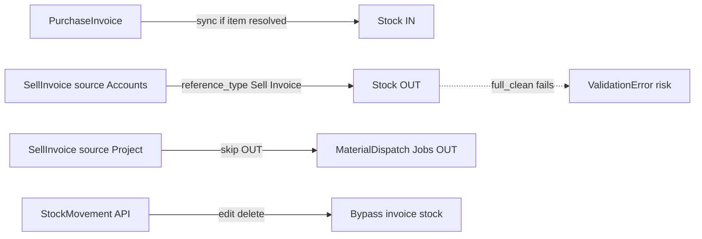

# Accounts ↔ Inventory ↔ Project — Audit Verdict & Recommendations

**Overview:** Read-only cross-check confirms your Accounts ↔ Inventory ↔ Project audit: Sell Invoice Stock OUT is broken at the reference-type level, unmapped physical lines can silently skip stock, and invoice-linked movements can be bypassed via the generic Stock Movement API. Below is the recommended fix order — no code changes in this step.

## Todos

- [ ] **P0:** Add Sell Invoice reference_type + migration + Stock OUT path
- [ ] **P0:** Explicit product vs service lines; no silent skip / no fuzzy match
- [ ] **P0:** Atomic invoice+stock+journal; block invoice-linked movement edit/delete
- [ ] **P1:** Purchase scope, project FK on movements, Accounts vs Project source rules
- [ ] **P2:** Reconciliation report + physical Sell OUT / bypass / E2E regression tests

---

## Verdict

**Agree with your audit.** System is **not fully reliable** for E2E stock + project accounting yet. Purchase IN path exists but is soft; Sell physical OUT has a **hard code-level failure** when inventory is linked; Project Billing duplicate-OUT design is correct in intent but Accounts vs Project source rules need stronger enforcement; generic Stock Movement API is a control gap.

## Claim-by-claim confirmation

| Your finding | Result |
|---|---|
| Sell Invoice uses `reference_type='Sell Invoice'` but choices lack it + `full_clean()` | **CONFIRMED** — [`document_services.py`](../backend/apps/accounts_module/document_services.py) ~435; [`inventory/models.py`](../backend/apps/inventory/models.py) choices + `save()`/`full_clean()` |
| Unmapped lines silently skip movement; invoice/journal still save | **CONFIRMED** — `_sync_document_line_stock` returns early if no item/warehouse |
| Sync only in `document_views` | **PARTIAL** — also called from [`billing_views.py`](../backend/apps/projects/billing_views.py) / dispatch; admin/script/model-save bypass still real |
| Project Billing skips Stock OUT; Accounts `source` read-only default Accounts | **CONFIRMED** |
| StockMovement API can edit/delete invoice-linked rows | **CONFIRMED** — plain `ModelViewSet`, no source guard |
| Purchase `project` optional; StockMovement has no project FK | **CONFIRMED** |
| E2E Sell Invoice uses Service / no `inventory_item` | **CONFIRMED** — masks Sell OUT bug |

**Extra risks confirmed:** fuzzy `name__icontains` item resolve; warehouse missing also silent-returns; Project billing still *calls* sell sync (no-ops OUT because `source='Project'`).

---

## Recommendations (priority order)

### P0 — Must fix before trusting stock

1. **Add `'Sell Invoice'` to `StockMovement.REFERENCE_TYPE_CHOICES`** (+ migration, filters, reports). Until this lands, any Accounts Sell Invoice with a resolved inventory line is at risk of failing on movement save.

2. **Stop silent skip for physical lines.** Classify lines as:
   - **Inventory product** → require explicit `inventory_item` (no ambiguous name match); fail API with line-level error if missing/inactive/no warehouse.
   - **Service / non-stock** → never create movement (explicit flag or category allowlist).

3. **Wrap invoice create/update** (lines + stock sync + journal + party balance) in **`transaction.atomic()`** so a failed Stock OUT does not leave a posted invoice without stock.

4. **Protect source-linked movements** in [`StockMovementViewSet`](../backend/apps/inventory/views.py): block update/delete when `reference_type` is invoice/challan/Jobs (or when reverse OneToOne to document line exists). Manual adjustments stay allowed only for `Manual` / authorized adjust workflow with reason.

### P1 — Project consistency & bypass hardening

5. **Keep Accounts vs Project Billing rules server-side:**
   - `source='Project'` → never Stock OUT from invoice (dispatch owns OUT).
   - Accounts invoices stay `source='Accounts'` and may Stock OUT for products.
   - Document the risk: Accounts product Sell Invoice on a project that already dispatched the same goods → double OUT; mitigate with FE warning + optional BE check against open/dispatched MaterialPlan qty.

6. **Purchase scope:**
   - General stock purchase → Project optional.
   - Project-specific purchase → Project mandatory (explicit field or scope flag).
   - Do **not** treat Purchase IN as Project actual material cost (keep cost on Dispatch @ inventory rate) — already your design; keep P&L that way.

7. **Project traceability on movements:** add nullable `project` FK (or indexed equivalent) on `StockMovement`; set it for project purchase / accounts project sell / dispatch; add `?project=` filter. Leave general warehouse receipts with `project=null`.

8. **Idempotent edit/cancel:** quantity/item change updates the same linked movement; cancel reverses stock; no duplicate movements on repeated save.

### P2 — Visibility & safety nets

9. **Read-only reconciliation report:** `current_stock` vs sum of movements; detect orphan/duplicate/mismatch/negative — **no auto rewrite** of production balances.

10. **Tests that currently miss the bug:** physical-item Accounts Sell OUT; unmapped physical line → 400; Project Billing no duplicate OUT; blocked movement API edit/delete; existing InvoicePaymentAllocation + Project Accounts connectivity must still pass.

11. **Frontend:** require Inventory Item on product lines; show stock impact; show linked movement on invoice detail; surface BE validation errors (no fake FE stock).

---

## What I would *not* do yet

- Auto-repair historical stock or rewrite production journals.
- Parallel inventory system / duplicate sync services.
- VPS deploy / production migrate / push without separate auth.
- Treat Purchase receipt as Project P&L material cost.

---

## Suggested next step (when you authorize Agent mode)

Implement **P0 only first** (Sell reference fix + line classification validation + atomic document sync + movement API source protection + regression tests), then P1 project FK/scope. Keep InvoicePaymentAllocation and Project Payment sync untouched.

**NOT DEPLOYED** recommendation stands until P0 tests are green locally.
