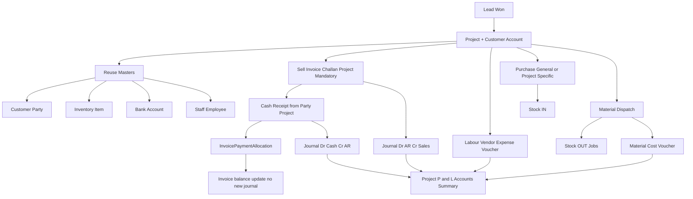
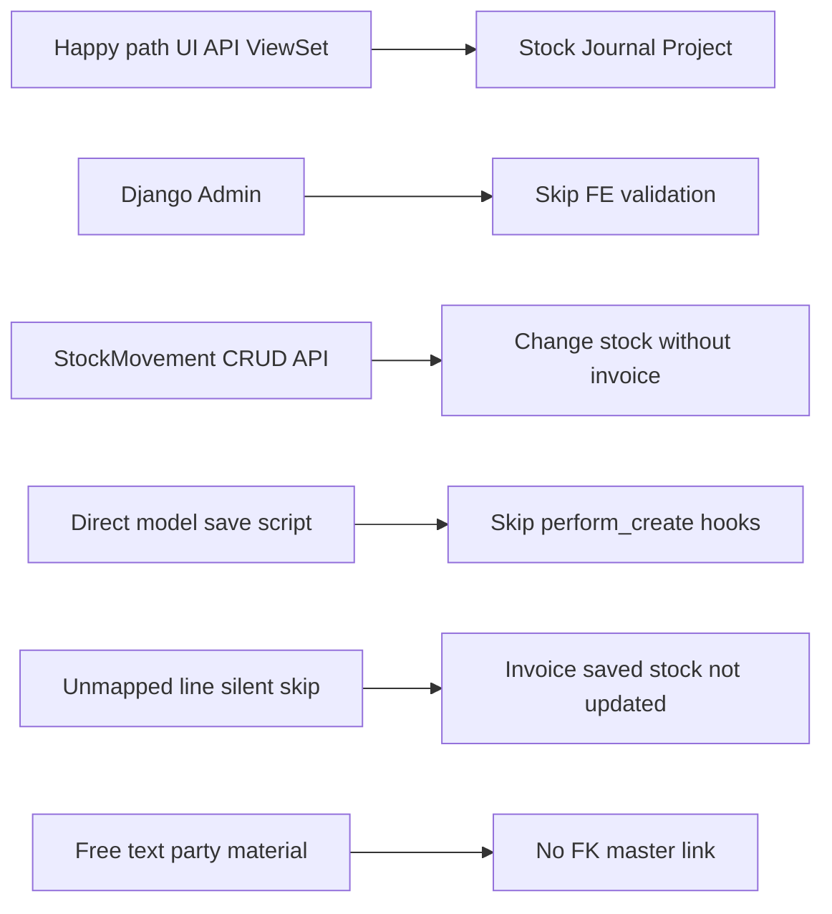

# Accounts — Project Workflow, Bypass & Master Data Reuse Plan

**Overview:** Accounts ka poora Project-centric workflow: abhi kya hai, ideal kya hona chahiye, data bypass kaise hota hai, aur CRM master data (Customer/Project/Inventory/Bank/Staff) forms mein dubara type na karke dropdown se pick ho.

## Todos

- [x] Phase A: Sell ref fix, line class, atomic sync, movement API protect
- [x] Phase B: Forms pick Customer/Project/Inventory/Bank — no re-type
- [x] Phase C: Purchase scope + StockMovement.project + double-OUT guard
- [x] Phase D: Regression tests + keep workflow MD updated

## Implementation status (living)

| Phase | Delivered |
|---|---|
| A | `Sell Invoice` in StockMovement REFERENCE_TYPE; NON_STOCK line class + no fuzzy match; atomic invoice+stock+journal in ViewSets; source-protected movement API edit/delete/create |
| B | Cash Receipt / Payment Received: ProjectSearchSelect, auto `received_from` / party name from master; solar docs party name read-only + inventory_item required for product lines; GST/site prefill from party/project |
| C | `PurchaseInvoice.procurement_scope` General vs Project; `StockMovement.project` FK + filter; FE dispatch double-OUT warning; BE guard blocks Accounts Sell Stock OUT when Jobs dispatch exists for same project+item |
| D | `tests_accounts_inventory_integration.py` + this MD kept as living workflow doc |

**Migrations:** `inventory.0009_stock_sell_invoice_project_procurement`, `accounts_module.0027_stock_sell_invoice_project_procurement`

---

## 1. Ideal workflow (poore CRM mein Accounts kaise chalna chahiye)

**Principle:** Payment = cash; Invoice = receivable; Allocation = settlement; Dispatch = actual material cost; Project ID = common link. Jo data CRM mein pehle se hai woh form mein **pick** hoga, dubara type nahi.

### Ideal stage rules

| Stage | Rule |
|---|---|
| Project | Customer from Customer Master / party; site fields from project |
| Sell Invoice / Challan | Project mandatory; Customer from project/party dropdown; product lines = Inventory Item pick |
| Cash Receipt | Party + Project pick; `received_from` auto from party/project; allocate to outstanding invoices |
| Invoice Allocation | One receipt → many invoices; no second cash journal |
| Labour / Vendor voucher | Payee from Vendor/Supplier/Employee; Project preferred/required for project cost |
| Purchase | General = Project optional; Project-specific = Project mandatory; lines = Inventory Item |
| Material Dispatch | Only path for project actual material Stock OUT + cost |
| Journals | Invoice = AR/AP accrual; Payment = cash; never double cash |
| P&L | Billed / Received / Allocated / Unallocated / Outstanding / Material / Labour / Other |

---

## 2. Abhi workflow kaisa hai (current)

| Area | Current behavior |
|---|---|
| Sell Invoice / Challan | Project BE+FE required; stock sync attempted; `source` Accounts vs Project |
| Cash Receipt | Project required (except Other); Invoice Allocation panel added |
| Project Payment | Idempotent sync → one Accounts Payment (`From Project`) |
| Payment Voucher | ProjectSearchSelect present; Labour category for P&L |
| Purchase | Project optional; Stock IN if item resolves |
| Dispatch | Stock OUT `Jobs` + cost voucher |
| Journals | Invoice always AR/AP (fixed); Payment posts cash |
| P&L / Accounts Summary | Live aggregates on Project Detail |

**Previously broken spots — now addressed in code:**

- Sell Invoice in StockMovement REFERENCE_TYPE + Stock OUT sync
- Unmapped physical lines raise ValidationError (no silent skip)
- StockMovement API + Admin protect invoice/dispatch-linked rows
- Accounts Sell + prior Jobs dispatch → BE guard + FE warning
- Cash Receipt / Payment Received aligned (allocation panel + project rules)
- See also living doc: [`accounts_inventory_project_workflow.md`](accounts_inventory_project_workflow.md)

---

## 3. Data bypass — kaise galat / parallel save ho sakta hai

| Bypass | Effect |
|---|---|
| StockMovement API | Invoice figures unchanged, stock changed |
| Admin / script | No FE Project/party rules |
| Silent skip stock | Accounts document without inventory effect |
| Free-text names | Duplicate “customers” / wrong inventory match (`icontains`) |
| Legacy Payment Received page | Weaker project/allocation rules |
| Challan + Invoice same goods | Double IN/OUT if both stock |

---

## 4. Master data reuse — pehle se CRM data form mein pick ho

**Rule:** Agar entity pehle se CRM mein hai → SearchableSelect / ProjectSearchSelect / lookup. Free-text sirf genuinely new / Other.

| Form field (abhi) | File | Should pick from |
|---|---|---|
| `received_from` (required text) | [`App.jsx`](../src/App.jsx) Cash Receipt | Auto-fill from selected Customer Party / Project.customer_name |
| `party_name` / `supplier_name` parallel text | [`accountsSolarPages.jsx`](../src/accountsSolarPages.jsx) | Party dropdown only; name read-only from selection |
| Cash Receipt `project` lookup | [`App.jsx`](../src/App.jsx) | Prefer [`ProjectSearchSelect.jsx`](../src/components/ProjectSearchSelect.jsx); filter by party |
| `project_ref` free text | Cash Receipt / payments | Outstanding Sell Invoice picker |
| Line `material_name` / `category` editable | [`accountsSolarPages.jsx`](../src/accountsSolarPages.jsx) | Fill from `inventory_item` pick; lock for product lines |
| Sell `gst_number` / `branch` / site | Sell forms | Party GSTIN / Project site_address |
| Other Expenses `payee_name` | [`App.jsx`](../src/App.jsx) | Vendor / Supplier / Employee directory |
| Payment Made / Cheque payee | [`App.jsx`](../src/App.jsx) | Party directory |
| Warehouse on stock lines | Missing in FE | Item warehouse / warehouse master |

**Already good patterns to extend:** Party/project/inventory pagination in solar pages; Voucher Vendor/Supplier/Employee selects; Customer Master hub; Invoice Allocation eligible-invoice list.

---

## 5. Recommended implementation order (jab Agent authorize ho)

### Phase A — Workflow integrity (P0 stock/bypass)

1. Fix Sell Invoice reference_type + physical Stock OUT
2. Product vs Service line rules (no silent skip)
3. Atomic invoice + stock + journal
4. Block invoice/dispatch-linked StockMovement edit/delete

### Phase B — Master data UX (no re-type)

5. Cash Receipt: auto `received_from`; ProjectSearchSelect; invoice picker for allocation/ref
6. Solar docs: party name read-only; product lines require inventory_item
7. Prefill GST/site from party/project
8. Align/remove legacy Payment Received weaker path OR apply same rules

### Phase C — Project procurement & traceability

9. Purchase scope General vs Project-specific
10. StockMovement.project FK + filter
11. FE warnings: Accounts Sell product on already-dispatched project

### Phase D — Tests & docs

12. Regression tests + update this MD as living workflow doc

**Strict:** no VPS deploy / no prod DB rewrite / preserve InvoicePaymentAllocation + Project Payment sync.

---

## 6. Short Hinglish summary

Ideal: Project ke around Accounts chale — invoice, receipt, allocation, voucher, dispatch, P&L ek Project ID se. Phase A–D implement ho chuke hain: Sell Invoice Stock OUT reference fix, line class validation, atomic sync, movement API protect, master-data pick UX, procurement scope, StockMovement.project, double-OUT FE+BE guard, aur regression tests (`tests_accounts_inventory_integration.py`).
