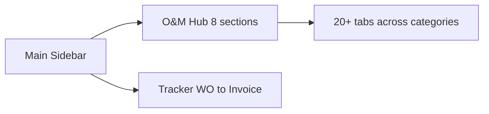

# O&M Slim Down Recommendation

**Goal:** O&M sidebar aur hub tabs ko overlap hata kar slim karna — recommended **5 main sections**, Tracker alag rakhna, unused/duplicate tabs merge ya hide.

---

## Current architecture (bloat)

Abhi CRM mein O&M related UI 3 layers pe fail hai:

### O&M hub (8 sections)

1. Dashboard & Plant List
2. Service Tickets & Complaints — 5 tabs (Tickets, Service Requests, Job Cards, Site Visits, Material Requests)
3. Quarterly Preventive Maintenance
4. Panel Cleaning Management
5. Warranty Management — 3 tabs
6. Insurance Management
7. Paid AMC Management — 3 tabs
8. Service History & Reports — 5 tabs

**Plus:** top-level **Tracker** (alag sidebar) — pre-O&M pending pipeline (Work Order → Quotation → Dispatch → Installation → Invoice).

---

## Safe to remove / merge (recommended)

| Item | Action | Why |
|------|--------|-----|
| Service Requests tab | Merge into Complaint Tickets | Same complaint/service intake flow |
| Site Visits tab | Merge into Job Cards | Visits already linked to job cards |
| Job Card History (Reports) | Remove from hub UI | Duplicate of Job Cards list with filters |
| Plant Performance + Generation Records | Merge as one "Monitoring" tab | Rarely used separately |
| Customer Feedback | Hide/remove from hub | Low daily use; API can stay |
| Panel Cleaning as separate section | Merge under Quarterly PM as tab | Both are scheduled maintenance |
| Warranty Claims vs AMC Claims | Keep one Claims under Warranty; AMC only Contracts + Renewals | Claims overlap |
| Equipment Replacement | Keep under Warranty as secondary tab | OK, but not top-level sidebar |

---

## Keep (core daily ops)

1. **Dashboard & Plants** — Dashboard + Plant List + Add Existing Plant
2. **Service Desk** — Complaint Tickets, Job Cards, Material Requests (max 3 tabs)
3. **Maintenance** — Quarterly PM + Cleaning (2 tabs)
4. **Coverage** — Warranties, Insurance, AMC Contracts/Renewals (tabs, not 3 separate sidebar items)
5. **Reports** — Service Reports + Monitoring (optional)

**Tracker** alag sidebar pe rehne do (pre-commissioning pipeline hai, O&M se alag kaam).

---

## Target sidebar under O&M (5 instead of 8)

1. Dashboard & Plants
2. Service Tickets & Job Cards
3. Maintenance (Quarterly + Cleaning)
4. Warranty / Insurance / AMC
5. Reports

---

## Implementation status (Task 15 — done locally)

- `src/omHubPages.jsx`: exactly **5** `OM_HUB_ROUTES` + nested `CATEGORY_TABS` + `OM_NAV_RESOLVE` legacy aliases.
- `src/App.jsx`: `omSubItems` from `OM_HUB_SECTIONS`; deep-links map via `OM_LEGACY_TO_SECTION`.
- Plant Digital History tabs in `src/omPlantPages.jsx` (Overview → Commissioning → Warranty → Monitoring → Docs → History…).
- Complaint request types expanded (FE + BE migration `0011`).
- **No DB delete** — navigation slim only; Tracker untouched.
- **No production deploy** without authorization.

---

## Out of scope

- Backend model deletion
- Tracker feature removal
- Production deploy (unless explicitly asked)

---

## Notes

- Yeh sirf **navigation / UX slim-down** plan hai — data aur APIs preserve rahenge.
- Purane deep-links / notification links ko new sections pe alias map karna zaroori hai taaki bookmarks break na hon.
